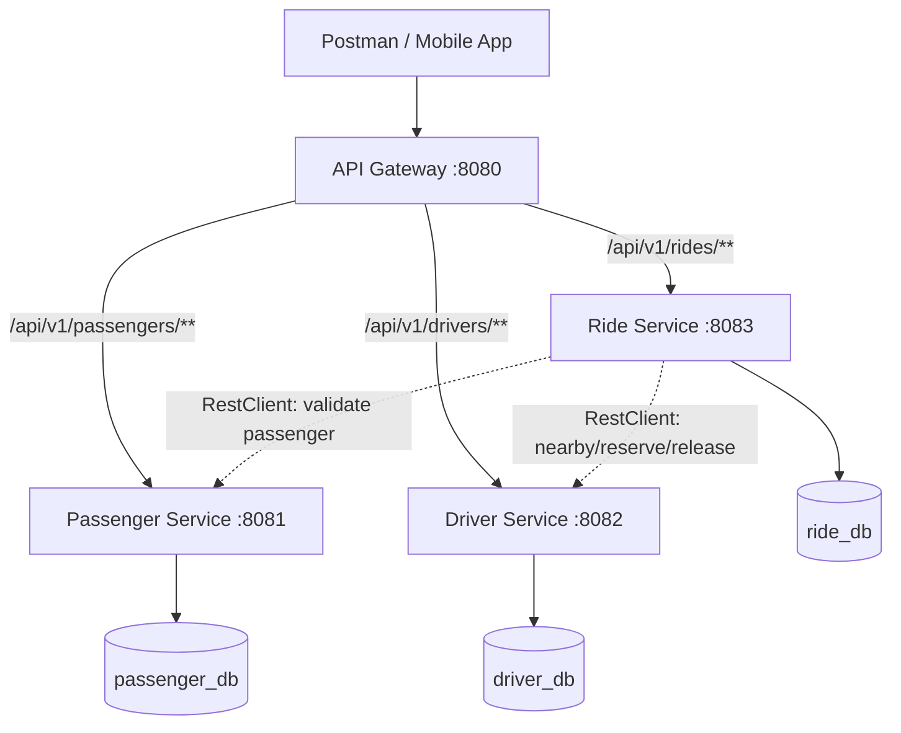

# API Gateway — Ride Sharing System

A Spring Cloud Gateway service that provides one HTTP entry point for the Passenger, Driver, and Ride microservices in the Ride Sharing project.

## 1. Why do we need an API Gateway?

Without a gateway, a client such as Postman or a mobile application must call each service at a different base address:

- Passenger Service: `http://localhost:8081`
- Driver Service: `http://localhost:8082`
- Ride Service: `http://localhost:8083`

With this gateway, clients use just **`http://localhost:8080`**, and the gateway forwards requests to the correct service. This is the **API Gateway Pattern** (a reverse proxy at the edge of a microservices system).



### Benefits

1. **Single entry point:** Client applications need one public base URL.
2. **Centralized routing:** Paths determine which backend receives each request.
3. **Reduced coupling:** Clients do not need to know individual backend ports or hostnames.
4. **Place for cross-cutting concerns:** Add JWT verification, CORS, rate limits, and gateway-level observability in future iterations.
5. **Deployment flexibility:** Backend addresses can later change without modifying every client, provided gateway routing is updated.

### Important limitations

- **The gateway currently performs routing only.** It does *not* automatically provide authentication, authorization, rate limiting, load balancing, service discovery, or fault tolerance.
- Backend services are still reachable directly on ports 8081–8083 in local development. In production, protect them at the network layer too.
- Ride Service can continue using its existing direct `RestClient` connections to Passenger and Driver Services. It does not need to call through the gateway.
- Gateway adds another deployed component. Health checks, monitoring, and sensible timeouts will be needed as the system grows.

## 2. Technology stack

| Technology | Version / purpose |
| --- | --- |
| Java | 17 |
| Spring Boot | 4.1.1 |
| Spring Cloud BOM | 2025.1.3 |
| Spring Cloud Gateway | Server WebFlux starter (managed by BOM) |
| Maven | Build and dependency management |
| Spring Boot Actuator | Gateway health endpoint |
| Port | 8080 |
| Database | None required |

Spring Cloud 2025.1.3 is compatible with Spring Boot 4.1.x. Gateway Server WebFlux uses Reactor Netty; it is different from the Spring MVC stack used by the existing backend services.

## 3. Folder structure

```text
api-gateway/
├── pom.xml
├── README.md
└── src/
    └── main/
        ├── java/
        │   └── com/ridesharing/gateway/
        │       └── ApiGatewayApplication.java
        └── resources/
            └── application.yml
```

## 4. Maven configuration (`pom.xml`)

```xml
<?xml version="1.0" encoding="UTF-8"?>
<project xmlns="http://maven.apache.org/POM/4.0.0"
         xmlns:xsi="http://www.w3.org/2001/XMLSchema-instance"
         xsi:schemaLocation="http://maven.apache.org/POM/4.0.0 https://maven.apache.org/xsd/maven-4.0.0.xsd">
    <modelVersion>4.0.0</modelVersion>

    <parent>
        <groupId>org.springframework.boot</groupId>
        <artifactId>spring-boot-starter-parent</artifactId>
        <version>4.1.1</version>
        <relativePath/>
    </parent>

    <groupId>com.ridesharing</groupId>
    <artifactId>api-gateway</artifactId>
    <version>0.0.1-SNAPSHOT</version>
    <name>api-gateway</name>

    <properties>
        <java.version>17</java.version>
        <spring-cloud.version>2025.1.3</spring-cloud.version>
    </properties>

    <dependencies>
        <dependency>
            <groupId>org.springframework.cloud</groupId>
            <artifactId>spring-cloud-starter-gateway-server-webflux</artifactId>
        </dependency>
        <dependency>
            <groupId>org.springframework.boot</groupId>
            <artifactId>spring-boot-starter-actuator</artifactId>
        </dependency>
        <dependency>
            <groupId>org.springframework.boot</groupId>
            <artifactId>spring-boot-starter-test</artifactId>
            <scope>test</scope>
        </dependency>
    </dependencies>

    <dependencyManagement>
        <dependencies>
            <dependency>
                <groupId>org.springframework.cloud</groupId>
                <artifactId>spring-cloud-dependencies</artifactId>
                <version>${spring-cloud.version}</version>
                <type>pom</type>
                <scope>import</scope>
            </dependency>
        </dependencies>
    </dependencyManagement>

    <build>
        <plugins>
            <plugin>
                <groupId>org.springframework.boot</groupId>
                <artifactId>spring-boot-maven-plugin</artifactId>
            </plugin>
        </plugins>
    </build>
</project>
```

**Avoid the earlier Maven issue:** The `<spring-cloud.version>` property must be declared because the Spring Cloud BOM references `${spring-cloud.version}`. No PostgreSQL, JPA, Lombok, or `spring-boot-starter-webmvc` dependency is needed in this Gateway project.

## 5. Application entry point (`ApiGatewayApplication.java`)

File: `src/main/java/com/ridesharing/gateway/ApiGatewayApplication.java`

```java
package com.ridesharing.gateway;

import org.springframework.boot.SpringApplication;
import org.springframework.boot.autoconfigure.SpringBootApplication;

@SpringBootApplication
public class ApiGatewayApplication {

    public static void main(String[] args) {
        SpringApplication.run(ApiGatewayApplication.class, args);
    }
}
```

## 6. Route configuration (`application.yml`)

File: `src/main/resources/application.yml`

```yaml
server:
  port: 8080

spring:
  application:
    name: api-gateway

  cloud:
    gateway:
      server:
        webflux:
          routes:
            - id: passenger-service
              uri: http://localhost:8081
              predicates:
                - Path=/api/v1/passengers,/api/v1/passengers/**

            - id: driver-service
              uri: http://localhost:8082
              predicates:
                - Path=/api/v1/drivers,/api/v1/drivers/**

            - id: ride-service
              uri: http://localhost:8083
              predicates:
                - Path=/api/v1/rides,/api/v1/rides/**

management:
  endpoints:
    web:
      exposure:
        include: health,info
```

**Version-specific detail:** For Spring Cloud Gateway Server WebFlux 5.x, the route property is `spring.cloud.gateway.server.webflux.routes`, not the older `spring.cloud.gateway.routes` property used in some tutorials.

This configuration **preserves the path**: no `StripPrefix` or `RewritePath` filter is needed because the existing controllers already use `/api/v1/...`.

## 7. Routing table

All gateway URLs begin with `http://localhost:8080`.

| Gateway path | Destination service | Destination port |
| --- | --- | --- |
| `/api/v1/passengers` | Passenger | 8081 |
| `/api/v1/passengers/{id}` | Passenger | 8081 |
| `/api/v1/drivers` | Driver | 8082 |
| `/api/v1/drivers/{id}` | Driver | 8082 |
| `/api/v1/drivers/nearby?...` | Driver | 8082 |
| `/api/v1/rides` | Ride | 8083 |
| `/api/v1/rides/{id}` | Ride | 8083 |
| `/api/v1/rides/{id}/assign` | Ride | 8083 |
| `/api/v1/rides/{id}/accept` | Ride | 8083 |
| `/api/v1/rides/{id}/start` | Ride | 8083 |
| `/api/v1/rides/{id}/complete` | Ride | 8083 |
| `/api/v1/rides/{id}/cancel` | Ride | 8083 |

For example:

`POST http://localhost:8080/api/v1/rides` → Gateway forwards the POST and JSON body to `http://localhost:8083/api/v1/rides`.

## 8. Create, import, and run in Eclipse

1. Create a new **Spring Starter Project** named `api-gateway` with Maven and Java 17.
2. Use Group `com.ridesharing`, Artifact `api-gateway`, and Package `com.ridesharing.gateway`.
3. Use the Maven file above, the main application class, and `application.yml`.
4. Right-click project → **Maven → Update Project**; enable **Force Update of Snapshots/Releases** when necessary.
5. Verify that Maven resolves all dependencies; ensure the project JRE is Java 17.
6. Start Passenger Service (`8081`), Driver Service (`8082`), and Ride Service (`8083`).
7. Right-click `ApiGatewayApplication.java` → **Run As → Spring Boot App**. Gateway should start on `8080`.

Optional Maven verification from the project root:

```bash
mvn -U clean test
mvn spring-boot:run
```

Make sure no other process is already listening on port `8080`.

## 9. Postman environment setup

Create a Postman environment named **Ride Sharing Local** with variables:

| Variable | Initial value | Purpose |
| --- | --- | --- |
| `baseUrl` | `http://localhost:8080` | API Gateway base URL |
| `passengerId` | ID of existing ACTIVE passenger | Used in booking |
| `driverId` | ID of an eligible driver | Used in driver checks |
| `rideId` | Blank initially | Filled after ride creation |

Use `{{baseUrl}}`, `{{passengerId}}`, and `{{rideId}}` in the requests below.

### Test 1 — Gateway health

- Method: **GET**
- URL: `{{baseUrl}}/actuator/health`
- Expected: HTTP `200` with `{"status":"UP"}`.
- Note: This checks Gateway itself, **not** the health of the three downstream services.

### Test 2 — Passenger routing

- Method: **GET**
- URL: `{{baseUrl}}/api/v1/passengers/{{passengerId}}`
- Expected: HTTP `200` and a passenger JSON object (if that ID exists).
- Verify `accountStatus` is `ACTIVE` for subsequent ride creation.

### Test 3 — Driver routing

- Method: **GET**
- URL: `{{baseUrl}}/api/v1/drivers/{{driverId}}`
- Expected: HTTP `200` and driver JSON details (if that ID exists).

### Test 4 — Nearby driver routing

- Method: **GET**
- URL: `{{baseUrl}}/api/v1/drivers/nearby?latitude=28.7041&longitude=77.1025&radiusKm=5`
- Expected: HTTP `200` and a JSON list; an empty list is valid if no nearby driver meets eligibility requirements.

### Test 5 — Create ride through Gateway

- Method: **POST**
- URL: `{{baseUrl}}/api/v1/rides`
- Header: `Content-Type: application/json`
- Body (**raw JSON**):

```json
{
  "passengerId": 1,
  "pickupLatitude": 28.7041,
  "pickupLongitude": 77.1025,
  "destinationLatitude": 28.6139,
  "destinationLongitude": 77.2090
}
```

**Replace `1` with your actual ACTIVE passenger ID.**

Expected: HTTP **201 Created**, `rideStatus` = `REQUESTED`, and a generated `id`.

Example response (values are illustrative):

```json
{
  "id": 11,
  "passengerId": 1,
  "driverId": null,
  "pickupLatitude": 28.7041,
  "pickupLongitude": 77.1025,
  "destinationLatitude": 28.6139,
  "destinationLongitude": 77.2090,
  "rideStatus": "REQUESTED",
  "requestedAt": "2026-10-18T12:00:00Z",
  "acceptedAt": null,
  "startedAt": null,
  "completedAt": null,
  "cancelledAt": null
}
```

Postman **Scripts → Post-response** tab (optional, saves the returned ID):

```javascript
pm.test("Ride created", function () {
    pm.response.to.have.status(201);
    pm.expect(pm.response.json().rideStatus).to.eql("REQUESTED");
});

const ride = pm.response.json();
pm.environment.set("rideId", ride.id);
```

### Test 6 — Read a ride

- Method: **GET**
- URL: `{{baseUrl}}/api/v1/rides/{{rideId}}`
- Expected: HTTP `200`, matching ride ID and `REQUESTED` status before assignment.

### Test 7 — List rides

- Method: **GET**
- URL: `{{baseUrl}}/api/v1/rides?page=0&size=10`
- Expected: HTTP `200` with a paginated response (`content`, `totalElements`, etc.).

### Test 8 — Passenger ride history

- Method: **GET**
- URL: `{{baseUrl}}/api/v1/rides/passenger/{{passengerId}}?page=0&size=10`
- Expected: HTTP `200` with a page of the passenger's rides.

### Prepare a driver before Test 9

Using your existing Driver Microservice APIs, ensure at least one candidate driver:

1. Has an `ACTIVE` account and `VERIFIED` verification status.
2. Has a registered vehicle.
3. Has recent latitude/longitude near the pickup location (updated within the configured eligibility window, typically 10 minutes).
4. Has availability `ONLINE`.
5. Can be reserved by the Driver Service `POST /api/v1/drivers/{id}/reserve?rideId={rideId}` endpoint.

If no driver is available, assignment may return `SEARCHING` instead of `ASSIGNED`, and you should not proceed to acceptance until assignment succeeds.

### Test 9 — Assign nearby driver

- Method: **POST**
- URL: `{{baseUrl}}/api/v1/rides/{{rideId}}/assign`
- Body: None.
- Expected: HTTP `200`, `rideStatus` = `ASSIGNED` and non-null `driverId` if a driver was reserved; otherwise `SEARCHING`.

### Test 10 — Accept ride

- Method: **PATCH**
- URL: `{{baseUrl}}/api/v1/rides/{{rideId}}/accept`
- Body: None.
- Expected: HTTP `200`, `rideStatus` = `ACCEPTED` and non-null `acceptedAt`.

### Test 11 — Start ride

- Method: **PATCH**
- URL: `{{baseUrl}}/api/v1/rides/{{rideId}}/start`
- Body: None.
- Expected: HTTP `200`, `rideStatus` = `IN_PROGRESS` and non-null `startedAt`.

### Test 12 — Complete ride

- Method: **PATCH**
- URL: `{{baseUrl}}/api/v1/rides/{{rideId}}/complete`
- Body: None.
- Expected: HTTP `200`, `rideStatus` = `COMPLETED` and non-null `completedAt`.
- Driver Service should release the driver whose reservation belongs to this ride. Your implementation makes the driver `OFFLINE` after release.

### Test 13 — Driver ride history

- Method: **GET**
- URL: `{{baseUrl}}/api/v1/rides/driver/{{driverId}}?page=0&size=10`
- Expected: HTTP `200`; includes this ride if `driverId` is the assigned driver ID.

### Test 14 — Cancellation (use a NEW ride)

1. Create a second ride using **Test 5**, saving its new ride ID.
2. Before starting it, call **PATCH** `{{baseUrl}}/api/v1/rides/{{rideId}}/cancel`.
3. Expected: HTTP `200`, `rideStatus` = `CANCELLED` and non-null `cancelledAt`.
4. If that ride had already been assigned a driver, the Driver Service must release the reservation first.

## 10. Negative and failure-path tests

| Scenario | How to test | Expected outcome |
| --- | --- | --- |
| Unknown ride | `GET /api/v1/rides/999999999` | `404` from Ride Service when no such ID exists |
| Invalid passenger | Create ride using a nonexistent ID | Usually `400`, based on current PassengerClient exception mapping |
| Blocked passenger | Create ride using a BLOCKED passenger | `400` from Ride Service |
| Invalid pickup latitude | Use `pickupLatitude: 120` | `400` from Ride Service |
| Invalid pagination | `GET /api/v1/rides?page=-1` | `400` from Ride Service |
| Accept REQUESTED ride | Call `/accept` before assignment | `409` from Ride Service |
| Complete before start | Call `/complete` in ASSIGNED/ACCEPTED state | `409` from Ride Service |
| Cancel COMPLETED ride | Call `/cancel` after completion | `409` from Ride Service |
| Downstream service stopped | Stop Passenger, Driver, or Ride and call its gateway route | Gateway or downstream reports a `5xx` failure; exact status can depend on configuration |
| Unknown gateway path | `GET /api/v1/unknown` | `404` (no matching route) |

Error status examples assume your existing `GlobalExceptionHandler` is configured to map the appropriate custom exceptions.

## 11. Troubleshooting

| Symptom | Fix |
| --- | --- |
| Maven error: `${spring-cloud.version}` | Declare `<spring-cloud.version>2025.1.3</spring-cloud.version>` in `<properties>`; update Maven |
| `spring-cloud-starter-gateway-server-webflux` version missing | Confirm the Spring Cloud BOM import under `<dependencyManagement>` resolves |
| Gateway starts, but all routes return 404 | Check the **`spring.cloud.gateway.server.webflux.routes`** property prefix and YAML indentation |
| Gateway cannot connect to a service | Check the target service port and application startup log |
| Gateway starts but `/actuator/health` fails | Confirm `spring-boot-starter-actuator` dependency is present |
| Port 8080 already in use | Stop the conflicting process, or use a different gateway port |
| Ride create returns 400 | Confirm passenger is ACTIVE and JSON coordinates are valid |
| Assignment is SEARCHING | Set up an eligible ONLINE, VERIFIED driver with vehicle and fresh GPS |
| Assignment fails during reserve | Confirm Driver Service implements the internal reserve/release endpoints with matching `rideId` semantics |
| Dependency conflict or unexpected server stack | Do not add `spring-boot-starter-webmvc` to this reactive gateway project |

## 12. What you learn (Spring Boot + HLD)

- **Reverse proxy and API Gateway architectural pattern**
- **Routing predicates** (`Path`) and route destination URIs (`uri`)
- **Edge service** versus business microservices
- **Separation of client-facing and service-to-service traffic**
- **Spring Cloud BOM dependency management**
- **Reactive HTTP networking** in Gateway Server WebFlux
- **Actuator health checks**, route testing, and failure-path testing
- **Future gateway filters** for authentication, CORS, rate limiting, and logging

## 13. Next development steps

1. Implement **Spring Security and JWT authorization** (with an authentication service or trusted identity provider), and enforce authorization in backend services as well.
2. Add sensible **timeouts and observability** at Gateway and downstream services.
3. Add **rate limiting**, **CORS rules** for your future frontend, and request correlation IDs.
4. Add **automated integration tests** for request routing and downstream failures.
5. Later consider **service discovery/load balancing** and Docker Compose or Kubernetes deployment.

## 14. Official references

- [Spring Cloud 2025.1.3 release announcement (Spring)](https://spring.io/blog/2026/08/20/spring-cloud-2025-1-3-has-been-released/)
- [Spring Cloud Gateway Server WebFlux starter documentation](https://docs.spring.io/spring-cloud-gateway/reference/spring-cloud-gateway-server-webflux/starter.html)
- [Spring Cloud Gateway 5.0.3 configuration properties](https://docs.spring.io/spring-cloud-gateway/reference/configprops.html)

---

**Local development convention:** Start the databases and Passenger/Driver/Ride services first, then run Gateway on port 8080. Use `http://localhost:8080` for all external Postman API tests.
